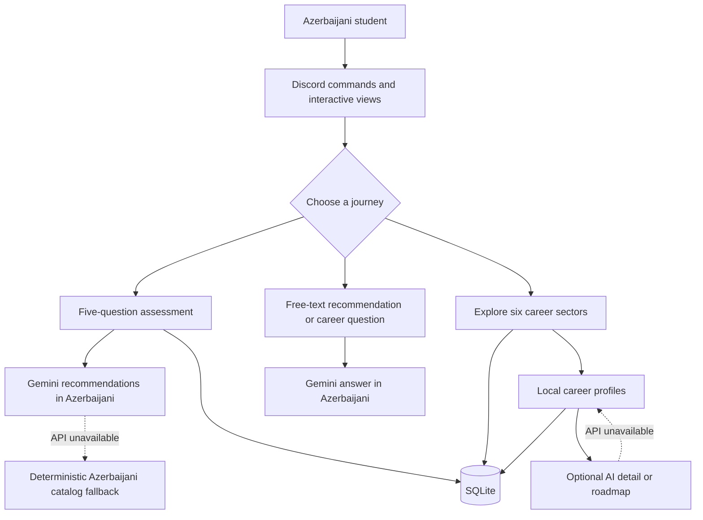

<div align="center">


# CareerCompass

### An AI-powered Discord bot for structured career exploration

[](https://github.com/Kvseis/CareerCompass/actions/workflows/tests.yml)
[](https://www.python.org/)
[](https://discordpy.readthedocs.io/)
[](https://ai.google.dev/)
[](https://www.sqlite.org/)

</div>

CareerCompass helps Azerbaijani students and career changers move from vague
interests to concrete directions. It combines a short interactive assessment,
a curated offline career catalog, and Gemini-powered explanations inside
Discord. The product experience is Azerbaijani-first, while the repository
documentation is written in English for international reviewers and
contributors.

The project is designed as an exploration aid—not a psychological assessment
and not a replacement for a qualified career counselor.

## At a glance

| | |
| --- | --- |
| **Primary audience** | Azerbaijani students and early-career learners |
| **Product language** | Azerbaijani by default |
| **Main experience** | Interactive Discord commands, buttons, and select menus |
| **Recommendation paths** | Gemini-generated guidance with a deterministic local fallback for the assessment |
| **Local data** | Curated Azerbaijani catalog across six sectors |
| **Persistence** | SQLite for users, results, favorites, and exploration history |
| **Quality checks** | 13 automated tests on Python 3.11 and 3.12 |
| **Public demo status** | Credential-free local demo; no permanently hosted bot yet |

## Why this project exists

Career information available to Azerbaijani students is often scattered,
generic, or difficult to turn into a first step. CareerCompass creates a
guided flow in the student's own language:

1. understand a user's interests and priorities;
2. suggest a small number of relevant directions;
3. explain the skills and learning path for each direction;
4. encourage further research and real-world experimentation.

## Features

- Five-question interactive career assessment
- Azerbaijani-first Discord interface, catalog, and AI responses
- Career exploration across six sectors
- Free-text AI recommendations and career Q&A
- Detailed career overviews and learning roadmaps
- Saved favorites and assessment history
- SQLite persistence
- Credential-free deterministic fallback when Gemini is unavailable
- Automated tests on Python 3.11 and 3.12

## Demo

Run the offline demo without Discord credentials or an AI key:

```bash
python scripts/demo.py
```

Example:

```text
CareerCompass - yerli demo
===============================
Nümunə profil:
  Maraqlar: texnologiya
  İş tərzi: komanda
  Prioritet: inkişaf
  Bacarıqlar: analitik düşüncə
  Təcrübə: başlanğıc

Tövsiyə olunan istiqamətlər:

1. Data Scientist
   Böyük məlumat massivlərini analiz edir, maşın öyrənməsi modelləri qurur...
   İlk addım: Python və Pandas öyrən (2 ay)
```

See the complete [demo guide](./docs/DEMO.md).

## How it works



The code is organized into four clear responsibilities:

1. **Discord delivery** — `cogs/` defines commands and `views/` manages the
   interactive user experience.
2. **AI guidance** — `gemini_client.py` builds constrained Azerbaijani prompts
   for recommendations, explanations, roadmaps, and career Q&A.
3. **Reliable local guidance** — `services/career_catalog.py` loads and ranks
   the Azerbaijani catalog when the assessment cannot reach Gemini.
4. **Persistence** — `database.py` stores test history, favorites, and
   exploration events in SQLite.

The guided assessment, career browsing, and local demo can still provide useful
information without a successful AI request. The free-text `/recommend` and
`/chat` commands require Gemini because their inputs cannot be answered by the
fixed catalog alone.

Read the full [architecture document](./docs/ARCHITECTURE.md).

## Azerbaijani-first by design

Yes—the bot is designed to answer in Azerbaijani.

- All primary commands, buttons, questions, loading states, and error messages
  are written in Azerbaijani.
- The Gemini system instruction explicitly requires natural, clear Azerbaijani
  and discourages artificial translation or unexplained jargon.
- The active offline catalog, fallback recommendations, and local demo are
  Azerbaijani.
- International career names such as *Frontend Developer* may remain in their
  commonly recognized form, while their explanations and guidance are
  Azerbaijani.
- The repository documentation is English so international admissions
  reviewers and contributors can evaluate the engineering work.

## What this project demonstrates

- **Problem selection:** a locally relevant education and career-guidance need
- **Product thinking:** short onboarding, three distinct user journeys, saved
  favorites, and clear next actions
- **Software architecture:** separation between Discord UI, AI integration,
  local recommendation logic, and persistence
- **Reliability:** useful fallback behavior instead of total failure when the
  AI service is unavailable
- **Responsible AI:** explicit limitations, realistic language, privacy notes,
  and no promise that a recommendation guarantees an outcome
- **Engineering quality:** deterministic core logic, automated tests, and a
  two-version continuous-integration matrix
- **Localization:** an Azerbaijani-first product with English technical
  documentation for international review

## Commands

| Command | Purpose |
| --- | --- |
| `/start` | Open the main menu |
| `/test` | Complete the five-question assessment |
| `/explore [sector]` | Browse careers by sector |
| `/recommend [description]` | Receive suggestions from a free-text profile |
| `/chat [message]` | Ask a short career-related question |
| `/favorites` | View saved careers |
| `/about` | Display project information |

## Quick start

### 1. Clone and create an environment

```bash
git clone https://github.com/Kvseis/CareerCompass.git
cd CareerCompass
python -m venv .venv
```

Activate the environment:

```bash
# Windows
.venv\Scripts\activate

# macOS / Linux
source .venv/bin/activate
```

### 2. Install dependencies

```bash
pip install -r requirements.txt
```

### 3. Configure credentials

Copy `.env.example` to `.env` and provide:

```dotenv
DISCORD_TOKEN=your_discord_bot_token
GEMINI_API_KEY=your_gemini_api_key
```

Create the Discord application in the Discord Developer Portal, enable the
required bot intents, and invite it with the `bot` and
`applications.commands` scopes.

### 4. Start the bot

```bash
python bot.py
```

## Testing

```bash
pip install -r requirements-dev.txt
python -m compileall -q .
pytest -q
```

The suite covers catalog integrity, deterministic fallback recommendations,
SQLite persistence, favorites, assessment history, and Discord embed builders.

## Project structure

```text
CareerCompass/
├── .github/workflows/     # CI test workflow
├── assets/                # Repository visuals
├── cogs/                  # Discord slash commands and events
├── docs/                  # Architecture and demo documentation
├── scripts/               # Credential-free local demo
├── services/              # Reusable catalog logic
├── tests/                 # Automated test suite
├── views/                 # Interactive Discord UI
├── bot.py                 # Application entry point
├── career_catalog.json    # Default Azerbaijani career data
├── career_catalog_en.json # Optional English reference dataset
├── database.py            # SQLite persistence
└── gemini_client.py       # Gemini prompts and client
```

## Responsible AI and privacy

- AI output is presented as exploratory guidance, not a guaranteed decision.
- Salary ranges are illustrative and vary significantly by location and experience.
- The application falls back to a transparent local catalog if Gemini fails.
- Discord IDs, display names, answers, results, and favorites are stored in a
  local SQLite database.
- Free-text descriptions and assessment answers may be sent to Gemini.
- Secrets are loaded from environment variables and excluded from version
  control.

## Current limitations

- The project does not yet provide a permanently hosted public Discord bot.
- The local scorer is intentionally lightweight and has not been validated as
  a psychological or academic assessment.
- Free-text AI recommendations and chat require a configured Gemini API key.
- Salary ranges are broad reference values and must be checked against the
  user's location and current market conditions.

## Roadmap

- Add recommendation-quality evaluation fixtures
- Add optional English and Turkish interfaces while keeping Azerbaijani as the default
- Add administrator-configurable privacy and retention controls
- Collect consent-based pilot feedback from students
- Build a lightweight web dashboard

## Contributing

Read [CONTRIBUTING.md](./CONTRIBUTING.md) before opening a pull request.

---

<div align="center">

Built by [Kvseis](https://github.com/Kvseis) as an exploration of responsible
AI, product design, and accessible career guidance.

</div>
