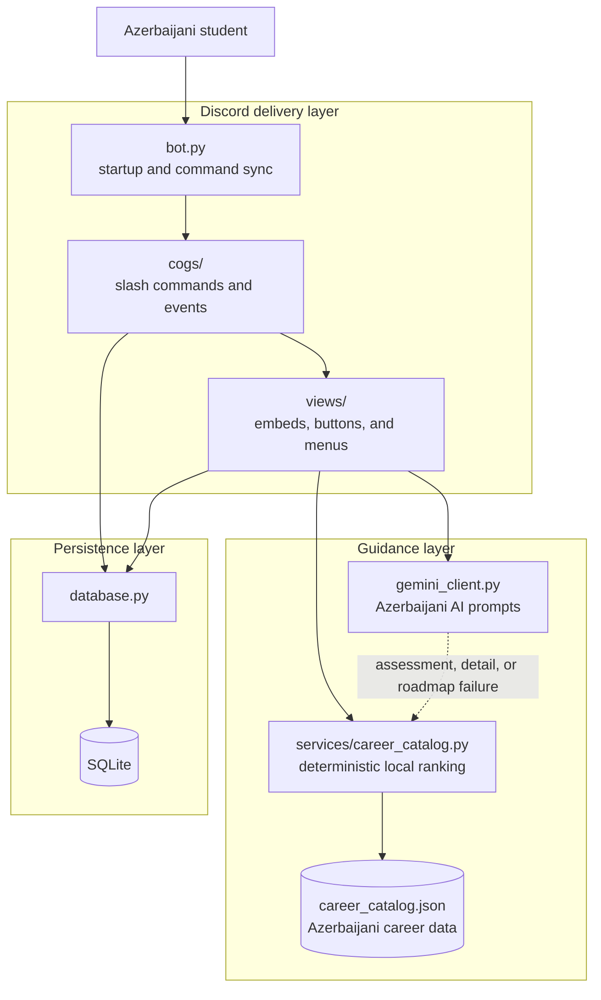
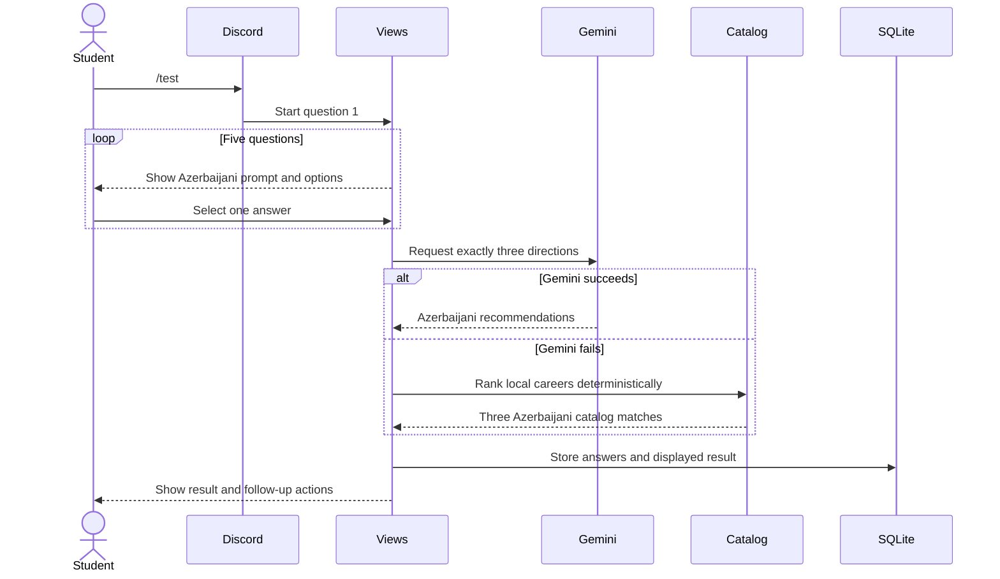
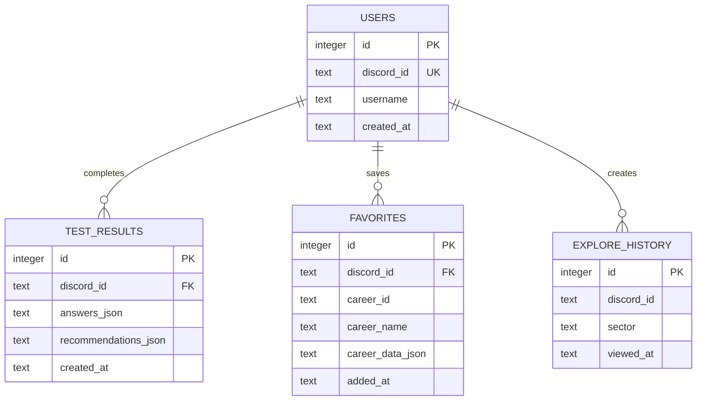

# CareerCompass Architecture

CareerCompass is an Azerbaijani-first Discord application for structured
career exploration. Its architecture separates the user interface, AI
integration, deterministic local guidance, and persistence so each part can be
understood and tested independently.

## Design goals

The system is built around five practical goals:

1. make career exploration approachable for Azerbaijani students;
2. keep the Discord experience short and easy to navigate;
3. provide useful guidance when the AI service is unavailable;
4. keep private configuration outside source control;
5. make core behavior testable without Discord credentials or an API key.

## System map

## Runtime startup

`bot.py` is the entry point. On startup it:

1. loads `DISCORD_TOKEN` and `GEMINI_API_KEY` from environment variables;
2. initializes the SQLite tables;
3. loads the command modules from `cogs/`;
4. connects to Discord and synchronizes slash commands;
5. exposes the interactive views used by each command.

## Main user journeys

| Journey | Entry point | Processing | Result |
| --- | --- | --- | --- |
| Guided assessment | `/test` or the main-menu test button | Five answers are sent to Gemini; the local scorer is used if the request fails | Three Azerbaijani career directions and next steps |
| Career exploration | `/explore` or the main-menu explorer | The local catalog supplies sectors and career profiles; Gemini can add detail or a roadmap | Comparable career information, favorites, and optional AI guidance |
| Free-text guidance | `/recommend` | The student's description is sent to Gemini | Three contextual Azerbaijani suggestions |
| Career Q&A | `/chat` | The question is sent to Gemini with the career-assistant system instruction | A concise Azerbaijani answer |
| Saved items | `/favorites` | SQLite retrieves or removes saved careers | A private list of the student's selected paths |

The fixed catalog can replace AI output for the guided assessment and for
career detail or roadmap requests. It cannot safely answer arbitrary free-text
questions, so `/recommend` and `/chat` report an error when Gemini is
unavailable.

## Assessment flow

## Why the bot answers in Azerbaijani

The Azerbaijani behavior is implemented at three levels rather than being only
a README claim:

1. **Interface:** `cogs/` and `views/` contain Azerbaijani command
   descriptions, questions, buttons, status messages, and errors.
2. **AI instruction:** `gemini_client.py` uses a shared system context that
   requires natural, clear, and correct Azerbaijani for every generated answer.
3. **Offline behavior:** `career_catalog.json` contains Azerbaijani
   descriptions and roadmaps, so fallback results remain Azerbaijani without
   Gemini.

Internationally recognized role names and technical terms can remain in
English when that is the clearest form. `career_catalog_en.json` is an inactive
reference dataset for future localization; the runtime loads
`career_catalog.json` by default. Technical documentation is English for
international reviewers and contributors.

## AI and fallback boundaries

| Capability | Gemini path | Local fallback |
| --- | --- | --- |
| Five-question assessment | Personalized explanation from all five answers | Deterministic ranking by selected sector, matching traits, and beginner suitability |
| Career detail | Expanded role explanation | Stored description, skills, work style, demand, and salary range |
| Learning roadmap | Generated staged plan | Stored roadmap and learning resources |
| Free-text recommendation | Contextual response | Not available |
| Career chat | Contextual response | Not available |

The local scorer is deliberately transparent and simple. It is a reliability
mechanism, not a psychological model or a claim of scientific career matching.

## Component responsibilities

| Component | Responsibility |
| --- | --- |
| `config.py` | Loads environment configuration and shared presentation constants. |
| `bot.py` | Creates the Discord client, initializes storage, loads modules, and synchronizes commands. |
| `cogs/welcome.py` | Implements `/start`, `/about`, and new-member onboarding. |
| `cogs/career_test.py` | Starts the guided assessment. |
| `cogs/career_explore.py` | Opens a sector directly or starts catalog exploration. |
| `cogs/recommendations.py` | Implements free-text recommendations, chat, and favorites management. |
| `views/main_menu.py` | Renders the three main entry points. |
| `views/test_views.py` | Owns the five-question state machine, AI request, and local fallback. |
| `views/explore_views.py` | Renders sectors, career profiles, details, roadmaps, and favorite actions. |
| `views/result_views.py` | Renders recommendations, history, and next actions. |
| `gemini_client.py` | Centralizes the model configuration and Azerbaijani prompt contracts. |
| `services/career_catalog.py` | Loads the catalog and provides deterministic recommendations. |
| `database.py` | Encapsulates SQLite operations for users, results, favorites, and exploration events. |

## Data model

SQLite stores JSON snapshots for answers, displayed recommendations, and saved
career data. This keeps the prototype simple and preserves what the student
actually saw at the time of the interaction.

## Reliability and testability

- The local catalog service has no dependency on Discord or Gemini.
- The fallback ranking is deterministic: the same input produces the same
  ordering.
- The credential-free demo exercises the local path from the command line.
- Thirteen tests cover catalog integrity, recommendation behavior, SQLite
  round trips, favorites, history, and key Discord embed builders.
- GitHub Actions compiles the code and runs the suite on Python 3.11 and 3.12.

## Privacy and responsible use

- Discord IDs, display names, answers, results, favorites, and exploration
  history are stored in the local SQLite database.
- Assessment answers and free-text messages may be sent to Gemini when an AI
  feature is used.
- API keys are read from environment variables and excluded from version
  control.
- AI output is framed as exploration, not a guaranteed decision or a
  professional psychological assessment.
- Salary ranges are illustrative and depend on location, experience, and
  market conditions.

## Known trade-offs and next steps

- SQLite is appropriate for a single-instance prototype; a multi-instance
  deployment would need a shared database such as PostgreSQL.
- Generated answers are constrained by prompts but still require evaluation
  fixtures for quality, consistency, and bias.
- A public deployment should add explicit consent, retention controls,
  observability, and rate limiting.
- Additional languages should be implemented as optional locale files while
  keeping Azerbaijani as the default experience.
