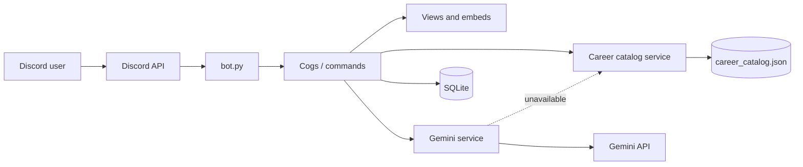
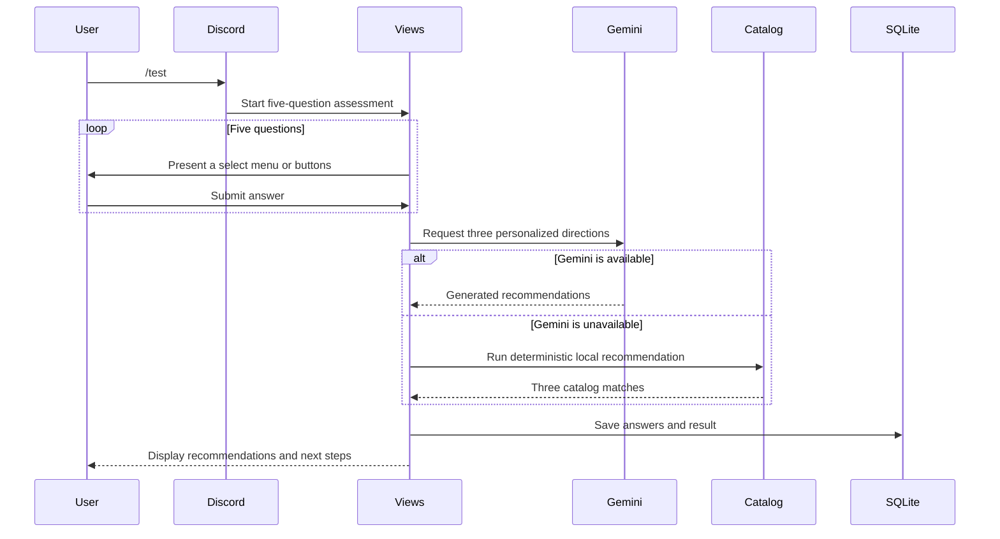

# CareerCompass Architecture

CareerCompass separates Discord-specific presentation from reusable data and
recommendation services. This makes the project testable without a live bot,
Discord server, or Gemini API key.

## System overview

## Components

| Component | Responsibility |
| --- | --- |
| `bot.py` | Creates the Discord client, loads extensions, synchronizes commands, and starts the application. |
| `cogs/` | Defines slash commands and event handlers. |
| `views/` | Renders embeds, buttons, and select menus for the interactive Discord flow. |
| `gemini_client.py` | Builds English prompts and isolates calls to Gemini. |
| `services/career_catalog.py` | Loads, validates, and queries the credential-free local catalog. |
| `database.py` | Persists users, assessment history, favorites, and exploration events in SQLite. |
| `career_catalog.json` | Stores the curated offline career dataset. |

## Assessment flow

## Data and privacy

- Discord user IDs, display names, assessment answers, results, favorites, and
  exploration history are stored in a local SQLite database.
- Free-text descriptions and assessment answers may be sent to Gemini when AI
  features are used.
- Tokens and API keys are read from environment variables and must never be
  committed.
- CareerCompass is an exploration tool, not a psychological test or a
  replacement for a qualified career counselor.

## Reliability strategy

The application keeps a local English career catalog so the assessment can
still return transparent, deterministic suggestions if Gemini is unavailable.
The local scorer is deliberately simple and is covered by automated tests.

## Extension points

- Replace SQLite with PostgreSQL behind the database interface.
- Add localization without changing command logic.
- Introduce a web dashboard that consumes the same catalog service.
- Add evaluation datasets for recommendation quality and bias review.

